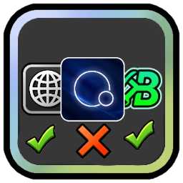

# List of Geode mods

> **DISCLAIMER:** this list is made for beginners who installed Geode yesterday.
> It is **my personal opinion** — install what you like and skip what you don't.
> Treat it as a starting point, not a rule: explore Geode yourself to find the mods that fit you.

A curated starter pack of the most useful [Geode](https://geode-sdk.org/) mods for Geometry Dash.
The mod itself adds no gameplay features — instead it **pulls in every mod from the list as a dependency**,
so one install gets you a complete, ready-to-play setup.

Every mod is described on the mod's page in-game (see [`about.md`](about.md)).



## Contents

- [What's inside](#whats-inside)
- [Installation](#installation)
- [Requirements](#requirements)
- [Notes & FAQ](#notes--faq)
- [Building from source](#building-from-source)
- [Credits](#credits)

## What's inside

**Bugfixes & Information**

| Mod | ID | Author |
| --- | --- | --- |
| Misc Bugfixes | `cvolton.misc_bugfixes` | cvolton |
| BetterInfo | `cvolton.betterinfo` | cvolton |

**Gameplay & Practice**

| Mod | ID | Author |
| --- | --- | --- |
| Death Tracker | `elohmrow.death_tracker` | abb2k |
| Attempt Playback | `manshoety.attemptplayback` | manshoety |
| Practice Checkpoint Permanence | `kevadroz.practicecheckpointpermanence` | Kevadroz |
| Rewind | `undefined0.rewind` | undefined0 |
| Automatic Quests | `glow12.automaticquests` | glow12 |

**Editor**

| Mod | ID | Author |
| --- | --- | --- |
| BetterEdit | `hjfod.betteredit` | HJfod |
| Circle Tool | `mat.circle-tool` | mat |
| Named Editor Groups | `spaghettdev.named-editor-groups` | spaghettdev |

**Interface & Quality of Life**

| Mod | ID | Author |
| --- | --- | --- |
| Eclipse | `eclipse.eclipse-menu` | ninXout & contributors |
| Level Thumbnails | `cdc.level_thumbnails` | cdc & prevter |
| Backups | `hjfod.backups` | HJfod |
| Trashcan | `hjfod.trashcan` | HJfod & SMJS |
| Search History | `hiimjustin000.search_history` | hiimjasmine00 |
| PRNTSCRN | `ninxout.prntscrn` | Erymanthus & contributors |
| Better Touch Prio | `alk.better-touch-prio` | undefined0 & altalk23 |

**Customization**

| Mod | ID | Author |
| --- | --- | --- |
| Texture Loader | `geode.texture-loader` | Geode Team |
| Texture Workshop | `uproxide.textures` | Naomi |
| More Icons | `hiimjustin000.more_icons` | hiimjasmine00 |
| Icon Gallery | `ml5.icon-gallery` | ML500 |
| Better Gauntlets | `dasshu.better-gauntlets` | DasshuDev |

**Libraries & APIs** (no features on their own — required by the mods above)

| Mod | ID | Author |
| --- | --- | --- |
| Node IDs | `geode.node-ids` | Geode Team |
| Editor Level ID API | `cvolton.level-id-api` | cvolton |
| ImagePlus | `prevter.imageplus` | prevter |
| GMD API | `hjfod.gmd-api` | HJfod |
| EditorTab API | `alphalaneous.editortab_api` | Alphalaneous |
| Cheat API | `legowiifun.cheat_api` | legowiifun |
| PersistenceAPI | `sabe.persistenceapi` | Sabe |
| Happy Textures x3c | `uproxide.happy_textures` | Naomi |
| Alpha's Geode Utils | `alphalaneous.alphas_geode_utils` | Alphalaneous |
| Alpha's UI Pack | `alphalaneous.alphas-ui-pack` | Alphalaneous |
| Badgified | `dasshu.badgified` | DasshuDev |
| Custom Keybinds | `geode.custom-keybinds` | Geode Team |

## Installation

1. Install Geode if you haven't already — [geode-sdk.org](https://geode-sdk.org/).
2. Open the in-game **Geode → Browse** tab, search for **List of Geode mods** and press *Install*.
3. Confirm the installation of the required dependencies — Geode downloads all of them automatically.

Manual installation: download the `.geode` file from the
[Geode website](https://geode-sdk.org/mods/) and drop it into your `geode/mods` folder.

## Requirements

| | |
| --- | --- |
| Geode | 5.11.2 or newer |
| Geometry Dash | 2.2081 |
| Platforms | Windows, macOS, Android, iOS |
| Dependencies | 34 mods (all listed above) |

## Notes & FAQ

**Why isn't mod X on the list?**
The list is deliberately small and beginner-oriented, and it is a matter of personal taste.
Some mods were excluded on purpose — for example *Auto Nong*, because it requires Jukebox
`2.11.0` exactly and breaks with the current Jukebox `3.8.0`.

**Will everything work together?**
The set was checked against the Geode index: all IDs exist, all required dependencies are
included, and every mod supports GD **2.2081**.

**Do I have to keep all of them?**
No. Dependencies are required by Geode while this mod is installed, but you can simply
uninstall this list mod afterwards — the mods you like will stay installed.

**Do I need every library?**
Yes, if you install the mod through Geode: the libraries in the *Libraries & APIs* section are
required by the mods above them. Install through Geode and dependencies are handled for you.

## Building from source

```sh
geode build
```

See the [Geode docs](https://docs.geode-sdk.org/getting-started/create-mod#build) for the full
setup, and use the matching Geode SDK version (this project is written against Geode 5.11.2).

## Credits

All listed mods are made and maintained by their respective authors — see the tables above and
[geode-sdk.org/mods](https://geode-sdk.org/mods). This project only curates them, bundles them
as dependencies and describes what they do.

Thanks to the [Geode Team](https://github.com/geode-sdk) for the SDK and for
[Node IDs](https://geode-sdk.org/mods/geode.node-ids).
